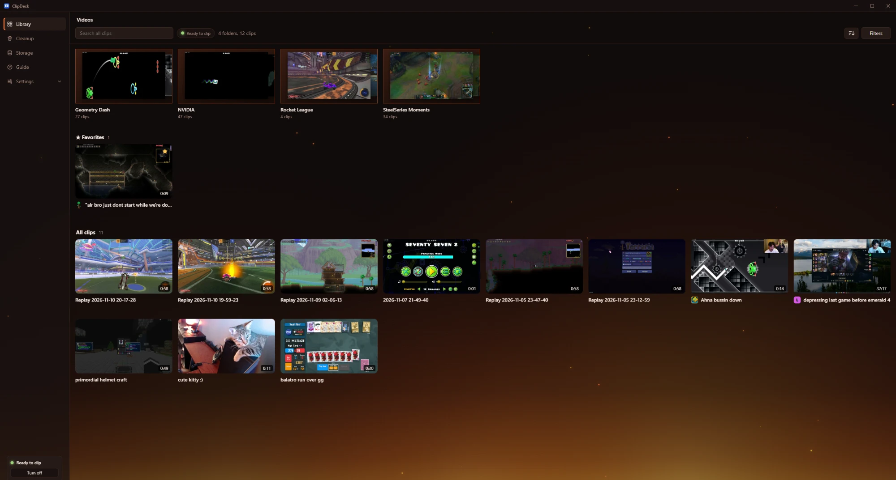
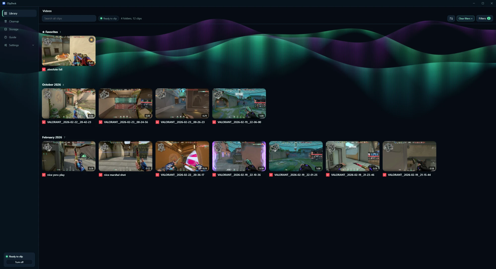
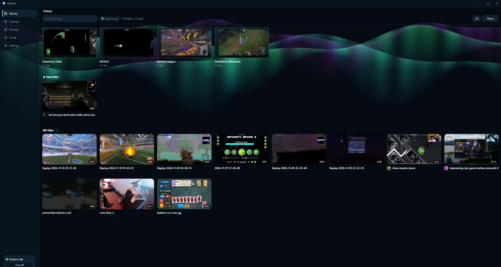
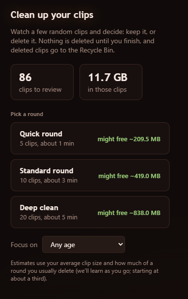
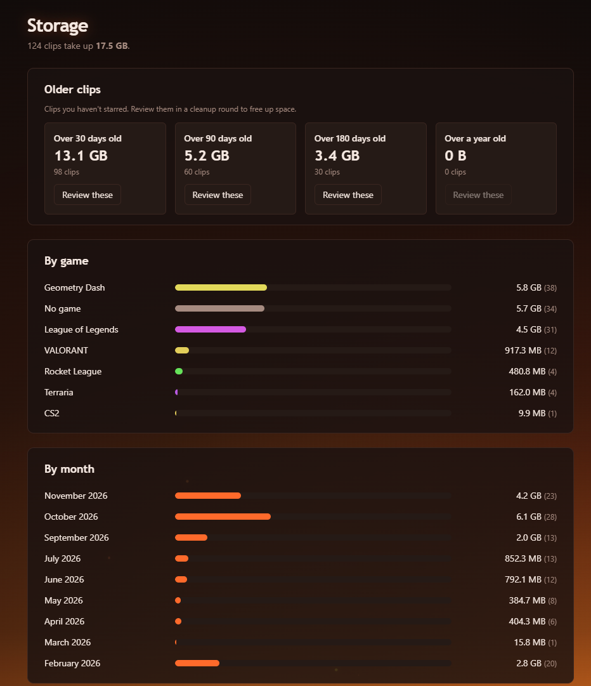

# ClipDeck

A clip manager for your OBS replay clips, in the style of Medal. It keeps your gameplay clips tidy,
sorted by game, and easy to watch, trim and share. Everything stays on your PC: no account, no cloud,
no tracking.

> Version 1.0. Bug reports and ideas are welcome: open an [issue](../../issues).

## Download

Get the latest installer from the **[Releases page](../../releases/latest)**. Download the
`ClipDeck_..._x64-setup.exe` file and run it.

Windows may say **"Windows protected your PC"** because the installer isn't signed yet. Click
**More info**, then **Run anyway**.

ClipDeck needs Windows 10 or 11 and [OBS Studio](https://obsproject.com) (free). The first time you open
ClipDeck, its **Guide** sets OBS up for clipping in a few clicks and gives you a short tour.

## Screenshots



| | |
|---|---|
|  |  |
|  |  |

## What it does

- **Library:** all your clips in one place, with thumbnails, search, filters and sorting. Folders work
  like real folders, and moving a clip in the app moves the file on your drive.
- **Sorted by game:** new clips are filed into a folder for the game you were playing.
- **Player:** switch between audio tracks (game, voice, music), step frame by frame, scrub quickly.
- **Trim and share:** lossless or precise trimming, and a Discord-sized copy placed on your clipboard.
- **Tags, favorites, notes** and powerful filters.
- **Cleanup:** a quick round of keep, delete, move or skip to clear out old clips.
- **Storage:** see what's using your space.
- **Popups and sounds** when a clip is saved, with themes to match, including animated premium themes.

## Privacy

ClipDeck only talks to OBS running on your own computer. It has no accounts, no telemetry and makes no
other network connections. Your clips are never uploaded or modified in place.

## Building from source

You need Rust, Node.js, FFmpeg and the Visual Studio C++ build tools (Windows).

```powershell
npm install
npx tauri-plugin-libmpv-api setup-lib   # downloads the mpv player libraries
npm run tauri dev                       # run the app
npm run setup-ffmpeg                    # before building an installer: bundles FFmpeg
npm run tauri build                     # creates the installer
```

Tests for the core logic: `cd crates/clipdeck-core && cargo test` (needs FFmpeg on your PATH).

## Third-party software

ClipDeck's installer includes [FFmpeg](https://ffmpeg.org) and [mpv](https://mpv.io)
(libmpv), which are separate projects with their own licenses. OBS Studio is not included; install
it from [obsproject.com](https://obsproject.com).
